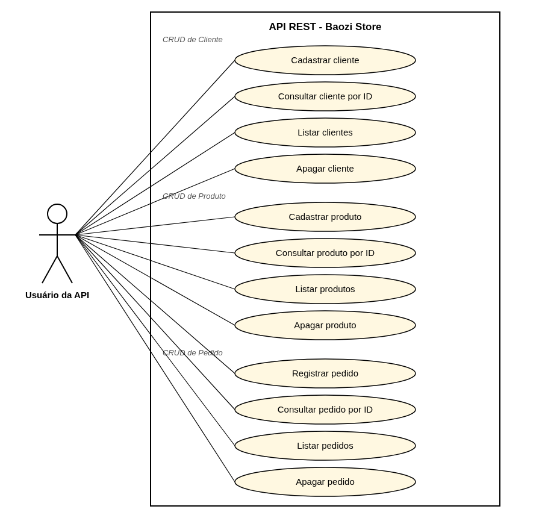

# Baozi Store - API REST

Trabalho de Desenvolvimento Web Back End (UNINTER) - Arthur Lira - RU 5279889

API REST simples para controlar clientes, produtos e pedidos da Baozi Store, uma loja de pão chinês.

**Tecnologias:** Java 17, Spring Boot 4.1.2, Spring Data JPA, banco H2, JSON, Postman.

## 1. Situação fictícia

A Baozi Store é uma pequena loja que vende pão chinês.
Para melhorar a organização do negócio, foi criado um sistema simples para controlar clientes, produtos e pedidos.
Um cliente chamado **ArthurLira5279889** realizou seu cadastro no sistema.
O produto vendido pela loja chama-se **Baozi de carne** e é vendido por unidade.
Em um determinado momento, o cliente realizou um pedido de **3** unidades do produto.
O sistema registra o cliente, o produto comprado e a quantidade solicitada, facilitando o controle da loja.

## 2. Diagrama de caso de uso



## 3. Especificação da API

### Entidades e campos

| Entidade | Campo | Tipo |
|---|---|---|
| **Produto** | id | Long (gerado pelo banco) |
| | nome | String |
| | preco | BigDecimal |
| | estoque | Boolean |
| **Cliente** | id | Long (gerado pelo banco) |
| | nome | String |
| | clienteDesde | LocalDate |
| **Pedido** | id | Long (gerado pelo banco) |
| | clienteId | Long (chave estrangeira para Cliente) |
| | produtoId | Long (chave estrangeira para Produto) |
| | quantidade | Integer |

No JSON, o pedido recebe o cliente e o produto como objetos com o `id` (ver exemplo abaixo) e devolve os dados completos deles.

### Endpoints

| Método | URL | Descrição | Resposta |
|---|---|---|---|
| POST | /clientes | Cria um cliente | 201 |
| GET | /clientes | Lista todos os clientes | 200 |
| GET | /clientes/{id} | Consulta um cliente por ID | 200 ou 404 |
| DELETE | /clientes/{id} | Apaga um cliente | 204 ou 404 |
| POST | /produtos | Cria um produto | 201 |
| GET | /produtos | Lista todos os produtos | 200 |
| GET | /produtos/{id} | Consulta um produto por ID | 200 ou 404 |
| DELETE | /produtos/{id} | Apaga um produto | 204 ou 404 |
| POST | /pedidos | Cria um pedido | 201 ou 400 (cliente ou produto não existe) |
| GET | /pedidos | Lista todos os pedidos | 200 |
| GET | /pedidos/{id} | Consulta um pedido por ID | 200 ou 404 |
| DELETE | /pedidos/{id} | Apaga um pedido | 204 ou 404 |

### Exemplos de corpo (JSON)

POST /clientes
```json
{ "nome": "ArthurLira5279889", "clienteDesde": "2026-11-17" }
```

POST /produtos
```json
{ "nome": "Baozi de carne", "preco": 5.50, "estoque": true }
```

POST /pedidos
```json
{ "cliente": { "id": 1 }, "produto": { "id": 1 }, "quantidade": 3 }
```

## 4. Prints do Postman

Importe a coleção `postman/baozi-store.postman_collection.json` no Postman e execute as requisições na ordem (1 a 12).

## Como rodar

Requisitos: JDK 17 ou superior.

```bash
./mvnw spring-boot:run
```

A API sobe em `http://localhost:8080`. O banco H2 é criado automaticamente na pasta `data/` e as tabelas são geradas pelo Hibernate (`spring.jpa.hibernate.ddl-auto=update`, em `src/main/resources/application.properties`).

Também dá para abrir a pasta como projeto Maven no Eclipse e rodar a classe `BaoziStoreApplication`.

## Estrutura

```
src/main/java/com/example/baozistore/
  BaoziStoreApplication.java
  model/        Cliente, Produto, Pedido
  repository/   ClienteRepository, ProdutoRepository, PedidoRepository
  controller/   ClienteController, ProdutoController, PedidoController
```
